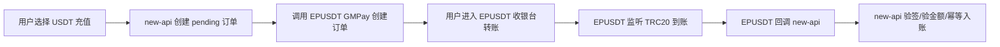

# USDT / EPUSDT 快速接入

本项目已经接入自建 USDT（EPUSDT / GM Pay）充值：用户在钱包页选择 `USDT (TRC20)` 后，new-api 会创建本地充值订单，调用 EPUSDT 创建链上支付订单，并通过 Webhook 自动入账。

## 1. 部署 EPUSDT

推荐使用官方 Docker 镜像：

```bash
mkdir -p /www/wwwroot/epusdt
cd /www/wwwroot/epusdt

cat > docker-compose.yml <<'EOF'
services:
  epusdt:
    image: gmwallet/epusdt:latest
    container_name: epusdt
    restart: always
    volumes:
      - ./env:/app/.env
    ports:
      - "8000:8000"
EOF

docker compose up -d
```

按官方 Docker 方式准备 `env` 配置文件并启动。至少需要设置 `app_uri`、`http_listen=:8000`、`db_type=sqlite`、`runtime_sqlite_filename=epusdt-runtime.db`、`api_rate_url`、`tron_grid_api_key` 等 EPUSDT 必需项。

安装完成后，在 EPUSDT 后台创建或查看商户 API Key，记录：

- `pid`：商户 PID，例如 `1000`
- `secret_key`：商户密钥，用于签名

## 2. 配置 new-api

可以使用环境变量，也可以在后台页面配置：`系统设置 -> 计费设置 -> 支付网关 -> USDT Gateway`。

环境变量示例：

```bash
EPUSDT_ENABLED=true
EPUSDT_URL=https://usdt.yourdomain.com
EPUSDT_PID=1000
EPUSDT_TOKEN=你的_EPUSDT_secret_key
EPUSDT_CURRENCY=usd
EPUSDT_TOKEN_SYMBOL=usdt
EPUSDT_NETWORK=tron
EPUSDT_UNIT_PRICE=1
EPUSDT_MIN_TOPUP=10
EPUSDT_MAX_TOPUP=10000
```

后台配置保存后无需把密钥暴露给前端；密钥字段为空时不会覆盖已有值。

## 3. Webhook 地址

EPUSDT 创建订单时会收到 new-api 传入的回调地址：

```text
https://你的-new-api域名/api/user/epusdt/notify
```

如果你的 `ServerAddress` 或反代地址不准确，可以配置：

```bash
EPUSDT_NOTIFY_URL=https://你的-new-api域名/api/user/epusdt/notify
EPUSDT_RETURN_URL=https://你的-new-api域名/console/topup?show_history=true
```

## 4. 充值流程



## 5. 常用检查命令

```bash
# new-api 是否下发 USDT 配置
curl -s https://你的-new-api域名/api/user/topup/info | jq '.data.enable_epusdt_topup,.data.pay_methods'

# EPUSDT 容器日志
docker logs -f epusdt

# new-api 容器日志
docker compose logs -f new-api
```

## 6. 注意事项

- 当前官方 EPUSDT 新接口为 `POST /payments/gmpay/v1/order/create-transaction`。
- 当前官方版本不再暴露旧的 `/api/v1/order/create-transaction`；只有对接旧部署时才开启 `EPUSDT_LEGACY_API=true`。
- `EPUSDT_TOKEN` 必须填写商户 `secret_key`，不是普通登录密码。
- 收款钱包需要按 EPUSDT 要求完成链上配置，并预留 TRX 用于 TRON 网络相关操作。

